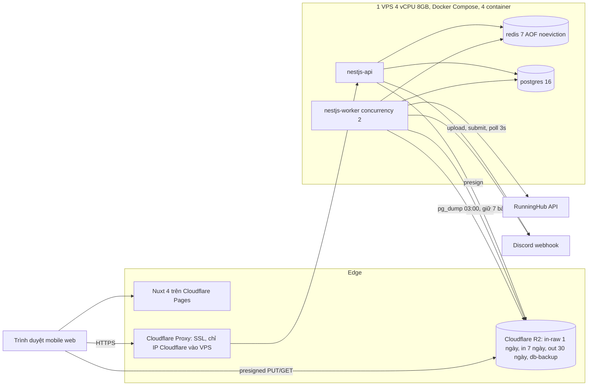
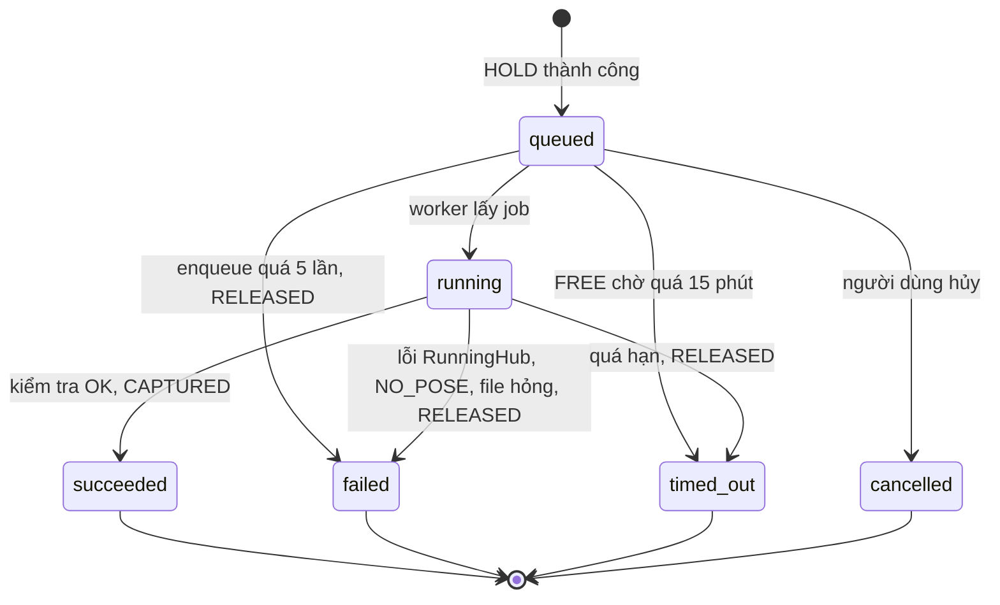
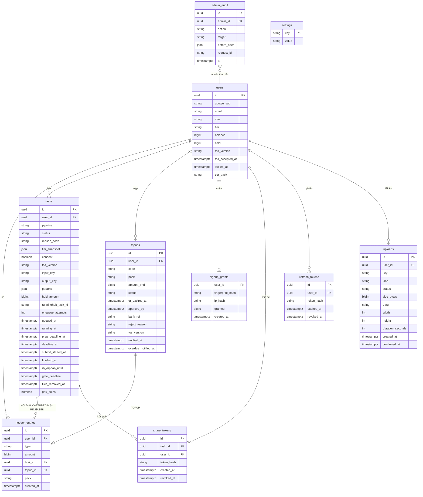

# Architecture Spine — flowvis

## Design Paradigm
**Modular monolith, ports-and-adapters**, một codebase NestJS chạy hai entrypoint (`api`, `worker`). Trạng thái Task và sổ cái credit nằm trong PostgreSQL và là nguồn sự thật duy nhất; Redis/BullMQ chỉ là phương tiện điều phối, mất đi vẫn dựng lại được từ DB.

| Lớp | Nơi ở | Quy tắc phụ thuộc |
| --- | --- | --- |
| Domain modules | `auth`, `wallet`, `tasks`, `pipelines`, `topups`, `storage`, `ops`, `audit` | module chỉ gọi module khác qua service public, không đọc bảng của module khác |
| Ports | `RunningHubPort`, `StoragePort`, `NotifierPort` | domain chỉ biết port |
| Adapters | `runninghub.adapter`, `r2.adapter`, `discord.adapter` | adapter không chứa luật nghiệp vụ |
| Entrypoints | `api` (HTTP), `worker` (BullMQ) | worker không mở HTTP công khai |

## Invariants & Rules

### AD-1 — Mỗi bảng có đúng một module chủ sở hữu ghi
- **Binds:** FR-9, FR-10, FR-11, FR-13, FR-14, NFR-4
- **Prevents:** hai module cùng ghi `ledger_entries` hoặc cùng một cột của `tasks` theo hai luật khác nhau
- **Rule:** chỉ `wallet` ghi `ledger_entries`, `users.balance`, `users.held`, `users.tier`; chỉ `tasks` ghi **mọi** cột của bảng `tasks` (kể cả `runninghub_task_id`, `gpu_coins`, `reason_code`, `tier_snapshot`, mốc thời gian) và chứa luôn bộ xử lý job BullMQ của worker (gọi `pipelines` qua port để dựng payload); chỉ `topups` ghi `topups`; `auth` ghi `users` (danh tính, `role`, `tos_*`, `locked_at`) và `signup_grants`; `storage` ghi `share_tokens`; `ops` ghi `settings`; `storage` cũng ghi `uploads` (sổ theo dõi tải lên); `tasks` ghi cột `files_removed_at`; `wallet` ghi `users.tier_pack`; **một service `audit` duy nhất** ghi `admin_audit` và mọi module gọi nó. `ops` và hàm vị trí hàng đợi đọc `tasks`/`ledger_entries` qua service public của chủ sở hữu (hàm đếm, không đọc bảng trực tiếp). Module khác gọi service của chủ sở hữu. Không có SQL thô ghi các bảng này ngoài chủ sở hữu. Cách hai module chung một transaction: AD-16.

### AD-2 — Sổ cái append-only, có dấu rõ ràng, số dư luôn bằng tổng bút toán
- **Binds:** FR-9, FR-10, FR-15, FR-16
- **Prevents:** Hold hoặc Release hai lần; trừ tiền hai lần do hiểu dấu khác nhau; số dư âm hoặc lệch sổ
- **Rule:** `ledger_entries` chỉ INSERT. Loại và dấu của `amount` (bigint, credit nguyên): `GRANT` +n, `TOPUP` +n, `ADJUST` ±n, `HOLD` −n (số dư khả dụng giảm ngay), `RELEASED` +n (trả đúng bằng HOLD của Task), `CAPTURED` 0 (đánh dấu chốt, không đổi số dư). Bất biến: `users.balance = SUM(amount)` của user đó; job đối soát chạy hằng ngày và cảnh báo khi lệch. `users.held` = tổng HOLD của các Task chưa có CAPTURED/RELEASED (do `wallet` giữ cùng transaction); `CAPTURED` giảm `held` mà không đổi `balance`, nên tổng sở hữu `balance + held` giảm đúng lúc credit bị tiêu. `wallet` đọc số tiền cần RELEASED/CAPTURED từ dòng HOLD của Task, không đọc từ bảng `tasks`. Vi phạm unique làm transaction PostgreSQL ở trạng thái aborted và Prisma không tự dùng savepoint, nên mọi lỗi P2002 trong luồng ví luôn **rollback toàn bộ transaction** và trả lỗi (CAS của AD-4 là chốt chính, unique chỉ là lưới an toàn); không chạy truy vấn tiếp trong transaction đã lỗi. Test CI bắt buộc: P2002 rồi connection pool trả về kết nối còn dùng được (issue adapter-pg vẫn mở). Ràng buộc DB: unique một phần `(task_id)` cho `HOLD`; unique một phần `(task_id)` cho tập `{CAPTURED, RELEASED}`; `CHECK (balance >= 0)`, `CHECK (held >= 0)`. Prisma không khai báo được chỉ mục một phần hay CHECK, nên các ràng buộc này nằm trong migration SQL thô, kèm test tích hợp chạy trên PostgreSQL thật trong CI khẳng định chúng tồn tại và từ chối ghi trùng.

### AD-3 — Trình tự tạo Task: kiểm tra, khóa, HOLD, rồi mới vào hàng đợi
- **Binds:** FR-1, FR-3, FR-6, FR-7, FR-8, FR-19
- **Prevents:** Task vào hàng đợi mà chưa có tiền giữ; Task có tiền giữ mà không có job; job cũ chặn việc enqueue lại
- **Rule:** thứ tự cố định: (1) validate đầu vào (AD-8, AD-11), `consent = true` và `users.locked_at IS NULL` (AD-18), (2) một transaction Prisma: khóa dòng user (`SELECT … FOR UPDATE` qua `tx.$queryRaw`), kiểm tra giới hạn tải (AD-17), `wallet.hold` (khóa user, kiểm số dư, chụp Tier Snapshot, INSERT `HOLD`), INSERT Task (`queued`, `queued_at`), (3) sau commit mới enqueue BullMQ với `jobId = taskId`, `removeOnComplete: true`, `removeOnFail: true` để không còn job cũ cùng id làm lần enqueue lại bị bỏ qua im lặng. Bộ quét (AD-6) enqueue lại mọi Task `queued` chưa có job, nên crash sau commit ở (2) và trước khi enqueue xong ở (3) không làm mất Task. Khóa dòng user, kiểm tra số dư, chụp Tier Snapshot và INSERT `HOLD` nằm trong `wallet.hold(tx, …)` (trả về Tier Snapshot); `tasks.create` mở `tx`, gọi `wallet.hold`, rồi INSERT Task, theo AD-16.

### AD-4 — Chuyển trạng thái bằng compare-and-set trên DB; Redis chỉ là gợi ý
- **Binds:** FR-10, FR-15, FR-17, FR-18
- **Prevents:** timeout, hủy, bộ quét và kết quả muộn ghi đè lẫn nhau; hoàn tiền hai lần; Task kẹt vì khóa Redis bị bỏ rơi
- **Rule:** mọi chuyển trạng thái là một câu lệnh `UPDATE tasks SET status=<to> … WHERE id=? AND status=<from>` theo bảng chuyển hợp lệ của AD-5, không dùng `status NOT IN (…)`. Chỉ bên có UPDATE ảnh hưởng đúng 1 dòng mới được tiếp tục; khi đó tiền (CAPTURED hoặc RELEASED) được ghi trong **cùng transaction** (AD-16). Bên ảnh hưởng 0 dòng bỏ qua im lặng. Redis `SET NX task:terminal:<taskId>` với TTL 30 giây chỉ là bộ lọc nhanh để tránh làm việc thừa; nó không bao giờ được chặn một bên đi tiếp tới câu lệnh DB, và mất hay mồ côi khóa không được làm Task kẹt. Tập trạng thái kết thúc: `succeeded`, `failed`, `timed_out`, `cancelled`.

### AD-5 — Vòng đời Task là máy trạng thái duy nhất, kèm mã lý do và nhánh khôi phục
- **Binds:** FR-5, FR-15, FR-16, FR-17
- **Prevents:** mỗi nơi tự đặt trạng thái và thông báo lỗi khác nhau; job được giao lại sau restart bị bỏ rơi hoặc làm lại từ đầu; trạng thái kết thúc dùng không thống nhất
- **Rule:** chuyển trạng thái chỉ qua `tasks.transition(taskId, from, to, reasonCode)`. Chuyển hợp lệ: `queued→running`, `queued→cancelled|timed_out|failed`, `running→succeeded|failed|timed_out`. `PREP_TIMEOUT` luôn là `timed_out` ở mọi nơi. MVP không có trạng thái `rejected` (Pre-check hoãn sang v2); mọi lỗi sau HOLD, kể cả `NO_POSE`, `NO_FACE`, là `failed`.
  - **Worker nhận một job** (kể cả job được giao lại sau restart) và đọc Task: `queued` → CAS `queued→running` (đặt `running_at`, `prep_deadline_at`), nếu 0 dòng thì đọc lại; `running` đã có `runninghub_task_id` → **tiếp tục poll**, không submit lại; `running` chưa có `submit_started_at` → nếu đã có `deadline_at` thì xét `deadline_at` (quá hạn thì `timed_out`/`RH_TIMEOUT`, chưa quá thì chạy lại từ bước (c) mà **không** đặt lại `deadline_at`); nếu chưa có `deadline_at` thì xét `prep_deadline_at` (chưa quá thì chạy lại bước chuẩn bị, quá hạn thì `timed_out`/`PREP_TIMEOUT`); `running` có `submit_started_at` nhưng chưa có id → `failed`/`RH_SUBMIT_UNKNOWN`; đã kết thúc → bỏ job.
  - `reasonCode` là enum lý do kết thúc Task dùng chung; lỗi API (từ chối ở route) là một enum riêng `ApiErrorCode` trong `packages/contracts` (`PAUSED`, `INSUFFICIENT_CREDIT`, `TASK_LIMIT`, `ACCOUNT_LOCKED`, `CONSENT_REQUIRED`, `VALIDATION_FAILED`, `RATE_LIMITED`): `RH_ERROR`, `RH_TIMEOUT`, `RH_SUBMIT_UNKNOWN`, `RH_BUDGET`, `PREP_TIMEOUT`, `RH_GATE_TIMEOUT`, `FFMPEG_ERROR`, `INPUT_FETCH_ERROR`, `OUTPUT_UPLOAD_ERROR`, `OUTPUT_INVALID`, `INTERNAL_ERROR`, `NO_POSE`, `NO_FACE`, `CONTENT_BLOCKED`, `FREE_WAIT_EXPIRED`, `USER_CANCEL`. Thông báo cho người dùng sinh từ `reasonCode`, không từ chuỗi lỗi thô của RunningHub.

### AD-6 — Một hàng đợi, hai Lane; worker poll RunningHub; bộ quét cưỡng chế hạn chót
- **Binds:** FR-8, FR-15, FR-17, NFR-1
- **Prevents:** vượt giới hạn của RunningHub; chạy trùng job; job treo giữ Lane; Task FREE chen ngang Task trả phí; Task `queued` hoặc `running` kẹt mãi; hủy Task không đồng bộ với hàng đợi
- **Rule:** một hàng đợi BullMQ cho cả ba Pipeline, `priority = Tier Snapshot priority` (số nhỏ chạy trước, cùng mức thì FIFO; không dùng priority 0), đúng một tiến trình `worker` với `concurrency = 2` (hai Lane). Priority không ngắt job đang chạy; hàng đợi một-lane là rủi ro đã chấp nhận (video dài của hạng cao có thể làm ảnh của hạng khác chờ vài phút).
  - **Cột thời gian của `tasks`:** `queued_at`, `running_at`, `prep_deadline_at` (= `running_at` + 120 giây, gồm tải input từ R2 và ffmpeg), `deadline_at`, `submit_started_at`, `finished_at`. `deadline_at` chỉ ghi một lần (`COALESCE`, không bao giờ đặt lại), đúng lúc bắt đầu tải input lên RunningHub = lúc đó + 180 giây (ảnh) hoặc 360 giây (video), gồm render và tải kết quả về R2.
  - **Trình tự trong job:** (a) bước chuẩn bị: kiểm cờ `rh_budget_exhausted` (đang bật thì `failed`/`RH_BUDGET` + RELEASED, chưa tốn ffmpeg); với video thì lấy khóa ffmpeg và cắt (AD-11); (b) cổng đồng thời: vì chỉ có một tiến trình worker, cổng là một **mutex trong tiến trình** bao quanh việc đếm và đặt chỗ; số Task đã qua cổng chưa kết thúc (gồm cả Task đang giữ chỗ nhưng chưa có id) cộng số job mồ côi còn trong `rh_orphan_until` phải nhỏ hơn `RH_MAX_CONCURRENT` (mặc định 2); không thì nhả mutex và hoãn 5 giây. Thời gian chờ cổng có hạn riêng `gate_deadline` = 15 phút kể từ `running_at` `[ASSUMPTION]`, quá hạn thì `timed_out`/`RH_GATE_TIMEOUT`, và mã này, cùng `PREP_TIMEOUT` do chờ cổng, **không** tính vào ngắt mạch AD-14 (chờ cổng không phải lỗi của chính Task); (c) đặt `deadline_at`, tải input lên; (d) ghi `submit_started_at`, submit, ghi `runninghub_task_id` ngay; (e) poll `POST /task/openapi/outputs` mỗi 3 giây (endpoint `/status` không còn được bảo trì); (f) nhập kết quả (AD-7).
  - **Mọi thao tác dài** (ffmpeg, HTTP tới RunningHub, tải/ghi R2) nhận `AbortSignal` hủy khi Task không còn `running` hoặc quá hạn; HTTP có timeout ≤ 10 giây; tiến trình ffmpeg bị kill khi bị hủy; kiểm tra trạng thái Task trước mỗi lần poll.
  - **Không submit lại:** RunningHub không có khóa idempotency, nên Task có `submit_started_at` mà chưa có id thì không bao giờ submit lại. Thử lại tự động chỉ áp dụng cho lỗi mạng khi request chưa gửi đi, đúng một lần. Task kết thúc `RH_TIMEOUT` hoặc `RH_SUBMIT_UNKNOWN` mà có khả năng job vẫn chạy bên RunningHub được đặt `rh_orphan_until` = lúc đó + 10 phút, và tính vào cổng đồng thời ở bước (b).
  - **Bộ quét** (chạy trong tiến trình worker, mỗi 30 giây): (1) Task `queued` thiếu job → enqueue lại với `tier_snapshot` và `queued_at` gốc, tăng `enqueue_attempts`; quá 5 lần thì `failed`/`INTERNAL_ERROR` + RELEASED; (2) Task FREE `queued` quá 15 phút → `timed_out`/`FREE_WAIT_EXPIRED`, xử lý theo lô có LIMIT; (3) Task `running` quá `deadline_at`, hoặc quá `prep_deadline_at` khi chưa có `deadline_at` → `timed_out` (`RH_TIMEOUT` hoặc `PREP_TIMEOUT`, cùng quy tắc với nhánh khôi phục AD-5), bất kể job còn sống hay không; (4) Task `running` không còn job sống và chưa quá hạn → enqueue job khôi phục (nhánh khôi phục AD-5); (5) mỗi lần CAS sang trạng thái kết thúc xong, xóa job BullMQ cùng `taskId` nếu còn (nỗ lực tốt nhất; job dư vẫn vô hại vì CAS).
  - **Hủy Task:** người dùng chỉ hủy được khi `queued`: API chạy CAS `queued→cancelled` + RELEASED (AD-16) rồi xóa job. Vị trí hàng đợi tính từ DB: số Task `queued` có `(priority, queued_at)` đứng trước.
  - Hủy job phía RunningHub không được dùng để bảo đảm tính đúng (endpoint chưa xác nhận). Không dùng webhook. Restart worker luôn an toàn nhờ nhánh khôi phục AD-5.

### AD-7 — Nhập kết quả: tải về R2, kiểm tra, rồi mới CAPTURED
- **Binds:** FR-2, FR-15, FR-16, NFR-2, NFR-7
- **Prevents:** trả link CDN RunningHub cho người dùng; CAPTURED cho file hỏng; mất số liệu chi phí thật
- **Rule:** khi `SUCCESS`, worker tải `fileUrl` về R2 (thử lại tối đa 3 lần trong `deadline_at`; hết 3 lần thì `failed`/`OUTPUT_UPLOAD_ERROR` + RELEASED), kiểm tra file (không rỗng, không toàn đen, video đúng độ dài ±0,5 giây), ghi EXIF (`Software: AI Generator`, `Comment: AI-Generated Content`), lưu `consumeMoney` vào `tasks.gpu_coins` và `finished_at` (cùng `running_at` dùng đo giây xử lý cho benchmark PRD §12), rồi mới chuyển `running→succeeded` kèm CAPTURED (AD-4, AD-16). Kiểm tra thất bại thì `failed`/`OUTPUT_INVALID` + RELEASED.

### AD-8 — Lưu trữ: tải lên trực tiếp rồi server sao chép sang khóa do server sở hữu
- **Binds:** FR-1, FR-3, FR-6, FR-7, NFR-2, NFR-6
- **Prevents:** API VPS phải gánh luồng file 100 MB; ghi đè file sau khi đã được kiểm tra; dùng chung khóa giữa người dùng; vượt giới hạn dung lượng; lạm dụng dung lượng lưu trữ; kết quả bị chia sẻ ngoài ý muốn
- **Rule:** trình duyệt PUT thẳng lên R2 bằng presigned URL với khóa do server sinh `in-raw/<userId>/<uuid>`. Khi người dùng xác nhận, server kiểm khóa thuộc đúng `userId`, `HEAD` đối tượng để lấy kích thước (10 MB ảnh, 100 MB video) và ETag, kiểm tra nội dung (định dạng, kích thước thật), rồi `CopyObject` sang khóa bất biến `in/<userId>/<uuid>` với điều kiện `CopySourceIfMatch = ETag`; ETag đổi thì từ chối. Task chỉ được dùng khóa `in/`. Mỗi người dùng có tối đa 10 đối tượng `in-raw/` chưa xác nhận, đếm bằng bảng `uploads` trong CSDL. Lifecycle R2 có độ phân giải tối thiểu 1 ngày: `in-raw/` xóa sau 1 ngày, `in/` sau 7 ngày, `out/` sau 30 ngày, và việc xóa có thể trễ tới khoảng 1 ngày. Bucket riêng tư, cấu hình CORS chỉ cho phép miền của FE; tải xuống bằng URL ký ngắn hạn. Chia sẻ công khai chỉ qua token do người dùng chủ động tạo cho từng kết quả: API phục vụ `GET /s/<token>` bằng cách chuyển hướng tới URL ký ngắn hạn của `out/`, và trang Nuxt SSR `/share/<token>` đặt thẻ Open Graph trỏ tới đường dẫn này (crawler luôn thấy URL ổn định, bucket vẫn riêng tư); Admin xóa token và file ngay (AD-18). Presigned PUT được ký kèm `Content-Length` đúng kích thước người dùng khai báo; dung lượng thật vẫn được `HEAD` kiểm lại.

### AD-9 — Nhận diện mặt và khung xương chạy trong workflow, không chạy model trên VPS
- **Binds:** FR-5
- **Prevents:** model nặng làm nghẽn CPU của VPS 4 vCPU; nhận diện pose chạy ở hai nơi
- **Rule:** phát hiện người, khuôn mặt, khung xương là node đầu tiên của workflow ComfyUI trên RunningHub, chạy sau HOLD; khi thất bại, workflow trả lỗi có tiền tố `NO_POSE` hoặc `NO_FACE`, worker ánh xạ sang `failed` + RELEASED. Server không chạy model nhận diện nào. Chấp nhận: ảnh không có mặt vẫn bị HOLD rồi hoàn lại, tốn dưới 1 giây GPU. MVP không có Pre-check nội dung tự động (PRD FR-20 hoãn sang v2). Lớp lọc nội dung của MVP là cam kết ToS (AD-18) cộng node lọc sẵn có trong workflow RunningHub; khi node này chặn, workflow trả lỗi có tiền tố `CONTENT_BLOCKED`, worker ánh xạ sang `failed` + RELEASED; thông báo cho người dùng: "Ảnh/video vi phạm tiêu chuẩn cộng đồng, vui lòng chọn file khác." Chuỗi lỗi thật mà node lọc trả về chưa biết, được bắt bằng 1–2 ảnh thử trong benchmark PRD §12 trước khi viết phần ánh xạ sang `CONTENT_BLOCKED`.

### AD-10 — Tier tính ở một nơi, trên tổng credit sở hữu, chụp Snapshot lúc tạo Task
- **Binds:** FR-8, FR-11, FR-12, FR-14
- **Prevents:** HOLD làm hạ Tier của chính Task đang chờ; nạp Starter sau khi hết tiền vẫn giữ Creator; hai nơi tính lại Tier ở thời điểm khác nhau; khóa nhiều dòng user gây deadlock
- **Rule:** chỉ `wallet` tính Tier và lưu `users.tier`, bằng một hàm thuần chạy trong cùng transaction với mọi bút toán làm **tổng sở hữu** thay đổi: `GRANT`, `TOPUP`, `ADJUST`, `CAPTURED`. Tổng sở hữu = `balance + held`; `HOLD` và `RELEASED` chỉ chuyển credit giữa `balance` và `held` nên tổng không đổi và không kích hoạt tính lại. Dưới 100 thì rơi về FREE và xóa gói đã nạp trước đó; lần `TOPUP` sau tính độc lập theo gói vừa nạp; khi còn credit thì giữ gói cao nhất. `tasks` lưu `tier_snapshot` (Tier, Priority, Cap); mọi bước sau của Task, kể cả enqueue lại, chỉ đọc snapshot. Mọi transaction chạm ví khóa đúng một dòng user (`FOR UPDATE`) và không khóa dòng user khác. PRD FR-11 đã khớp công thức này.

### AD-11 — Giá do server quyết định; ffmpeg cắt video trên worker, một tiến trình mỗi lúc
- **Binds:** FR-6, FR-7, FR-1, FR-3
- **Prevents:** giá FE hiển thị khác giá bị HOLD; khai gian độ dài Trim; hai bảng giá song song; ffmpeg nuốt CPU của VPS; thời gian chờ ffmpeg làm Task timeout giả
- **Rule:** bảng giá và Cap nằm ở một cấu hình phía server, FE lấy qua API và không tự hardcode. Backend dùng `ffprobe` đo độ dài thật của `pose_video`, kiểm `trim_start`/`trim_end` nằm trong video, bước 1 giây, 3 giây ≤ độ dài ≤ Cap, rồi tự tính giá = 50 × số giây. Ảnh được resize về cạnh dài tối đa 2048 px bằng `sharp` trước khi vào workflow. Việc cắt video do worker làm bằng ffmpeg (không dùng tham số cắt của node ComfyUI): re-encode libx264 preset veryfast, chuẩn hóa 24 FPS, `nice` thấp. **Cơ chế giới hạn duy nhất là một khóa trong tiến trình worker**, nên tại một thời điểm chỉ một ffmpeg chạy; Lane còn lại chờ khóa. Thời gian chờ khóa và cắt nằm trong `prep_deadline_at` (AD-6), không tính vào `deadline_at`. Worker tải **đoạn đã cắt** lên RunningHub; file gốc chỉ nằm trên R2.

### AD-12 — Đăng nhập Google qua NestJS, tặng credit chống lạm dụng ngay trong transaction đăng ký
- **Binds:** FR-12, NFR-3
- **Prevents:** một thiết bị nhận credit tặng hai lần; cấp 500 credit ngoài sổ cái; đếm IP sai sau proxy hoặc bị đua khi đăng ký đồng thời; CSRF
- **Rule:** OAuth Google trực tiếp trong NestJS, JWT truy cập ngắn hạn cộng refresh token trong cookie httpOnly, `Secure`, `SameSite=Lax`; FE (`app.<tên miền>`) và API (`api.<tên miền>`) cùng tên miền gốc. Khi tạo user: một transaction lấy `pg_advisory_xact_lock(hash IP)`, kiểm tra `signup_grants` (unique theo hash fingerprint; đếm IP trong 24 giờ), rồi INSERT `GRANT` 500 hoặc 0 credit. IP lấy từ header `CF-Connecting-IP`, và chỉ tin header này khi kết nối đến từ dải IP của Cloudflare (cấu hình `trust proxy` của NestJS theo danh sách dải đó, tường lửa VPS cũng chỉ mở cổng API cho các dải này); mọi yêu cầu không từ Cloudflare bị bỏ.

### AD-13 — Nạp tiền VietQR: hạn QR tách khỏi hạn duyệt, mỗi mã và mỗi giao dịch ngân hàng dùng một lần
- **Binds:** FR-13, FR-14
- **Prevents:** đơn đã chuyển tiền ngoài giờ bị hết hạn oan; duyệt hai lần cộng credit hai lần; một chuyển khoản duyệt cho nhiều đơn; admin sửa số dư không để lại dấu vết
- **Rule:** `topups(code unique, pack, amount_vnd, status, qr_expires_at, approve_by, bank_ref unique nullable, reject_reason)`, số tiền cố định lúc tạo. Trạng thái: `awaiting_transfer` (QR do server sinh theo chuẩn VietQR/EMVCo bằng thư viện cục bộ, không gọi dịch vụ ngoài; tài khoản nhận tiền cấu hình bằng biến môi trường) → `pending` (người dùng bấm "Đã chuyển khoản"; mỗi đơn chuyển sang `pending` gửi một thông báo Discord webhook cho Admin, đánh dấu bằng `notified_at` để không gửi lặp) → `approved` | `rejected` | `needs_review` ("Cần xem xét" khi Admin thấy sai số tiền hoặc nội dung); `awaiting_transfer` quá `qr_expires_at` (15 phút) → `expired`. Đơn `pending` **không** hết hạn: `approve_by` = 15 phút sau thời điểm đầu tiên nằm trong khung 08:00–23:00 giờ Việt Nam; quá `approve_by` đơn vẫn chờ nhưng được đánh dấu quá hạn và gửi cảnh báo Discord webhook. Mọi lần duyệt, ở bất kỳ trạng thái nào, bắt buộc nhập `bank_ref` (unique), nên một chuyển khoản không duyệt được cho hai đơn; duyệt đơn `expired` đi đường riêng có ghi `admin_audit`. Từ chối bắt buộc `reject_reason`. `needs_review` quay về `pending` khi Admin xử lý xong hoặc sang `rejected`. Bộ quét của `ops` (chạy cùng chu kỳ AD-6) đổi `awaiting_transfer` quá hạn sang `expired` bằng UPDATE có điều kiện (người dùng bấm "Đã chuyển khoản" cùng lúc thì ai thắng CAS đi tiếp) và gửi cảnh báo Discord webhook một lần cho mỗi đơn quá `approve_by` (cột `overdue_notified_at`). Đơn `needs_review` tính vào giới hạn 3 đơn. Cam kết ToS khi nạp tiền lưu ở `topups.tos_version`. Duyệt chuyển trạng thái bằng UPDATE có điều kiện, cùng transaction với INSERT `TOPUP` (unique theo `topup_id`) và tính lại Tier. Mỗi người dùng tối đa 3 đơn `awaiting_transfer` hoặc `pending`. Mọi thao tác duyệt, từ chối, điều chỉnh ghi `admin_audit` (ai, khi nào, trước/sau). Route admin chỉ cho role `admin`.

### AD-14 — Ngắt mạch chỉ đếm lỗi hệ thống, lưu bền trong DB
- **Binds:** FR-18, NFR-7
- **Prevents:** người dùng gửi ảnh xấu làm bật ngắt mạch và chặn khách trả phí; cờ tạm dừng mất khi khởi động lại; ngắt mạch bật lại ngay sau khi Admin tắt; không phát hiện sự cố khi lưu lượng thấp
- **Rule:** `ops` tính trên bảng `tasks`. **Lỗi hệ thống** gồm `failed` và `timed_out` với `reasonCode` thuộc `RH_ERROR`, `RH_TIMEOUT`, `RH_SUBMIT_UNKNOWN`, `PREP_TIMEOUT` (do ffmpeg), `FFMPEG_ERROR`, `INPUT_FETCH_ERROR`, `OUTPUT_UPLOAD_ERROR`, `OUTPUT_INVALID`, `INTERNAL_ERROR`. Mẫu số: mọi Task đã tới trạng thái kết thúc trừ các lý do do người dùng, ngân sách hoặc hàng đợi (`NO_POSE`, `NO_FACE`, `CONTENT_BLOCKED`, `USER_CANCEL`, `FREE_WAIT_EXPIRED`, `RH_BUDGET`, `RH_GATE_TIMEOUT`). Cửa sổ trượt 30 phút; chỉ tính các Task kết thúc sau `settings.breaker_reset_at` (Admin đặt khi tắt cờ). Bật `settings.intake_paused` khi tỷ lệ vượt 15% với ít nhất 20 Task, **hoặc** khi có 5 lỗi hệ thống liên tiếp bất kể lưu lượng; đồng thời gọi `NotifierPort` (Discord webhook). API trả 503 `PAUSED` chỉ cho route tạo Task; đăng nhập, nạp credit, lịch sử, tải kết quả không bị chặn. Khi RunningHub từ chối vì hết tiền, Task đó `failed`/`RH_BUDGET` + RELEASED, đặt cờ `rh_budget_exhausted` và `intake_paused`; worker thấy cờ này thì thất bại nhanh các Task còn trong hàng đợi trước khi chạy ffmpeg. `ops` poll số dư RunningHub và cảnh báo khi dưới USD 15; Admin tắt **cả hai** cờ (`intake_paused`, `rh_budget_exhausted`) bằng một thao tác duy nhất ghi `breaker_reset_at`; ngắt mạch chỉ được đánh giá sau mỗi lần một Task kết thúc, và một Task thành công cắt chuỗi "5 lỗi liên tiếp" còn các lý do loại trừ thì không cắt cũng không tính. Chi phí `consumeMoney` cũng được đọc và lưu khi Task `FAILED` nếu RunningHub trả về, để SM-4 không bị đánh giá thấp.

### AD-15 — Redis chỉ là phương tiện, cấu hình bền và không đẩy dữ liệu
- **Binds:** FR-8, NFR-4
- **Prevents:** BullMQ mất job do Redis đẩy khóa khi đầy bộ nhớ; coi Redis là nguồn sự thật
- **Rule:** Redis 7 cấu hình `appendonly yes`, `appendfsync everysec`, `maxmemory-policy noeviction`; kết nối của worker đặt `maxRetriesPerRequest: null`. Mọi dữ liệu trong Redis dựng lại được từ PostgreSQL (qua bộ quét AD-6). Không lưu số dư, trạng thái Task hay cờ vận hành duy nhất trong Redis.

### AD-16 — Module chủ giao dịch mở `tx`, module khác nhận `tx`
- **Binds:** FR-9, FR-10, FR-12, FR-13, FR-15, FR-16, NFR-4
- **Prevents:** Task ở trạng thái kết thúc mà không có bút toán (hoặc ngược lại) vì hai transaction riêng; module phá AD-1 để đạt tính nguyên tử; số tiền hoàn lệch với số tiền đã giữ; mỗi luồng tự chọn cách chung transaction
- **Rule:** với mọi thao tác cần ghi bảng của hai module, **module chủ của luồng mở transaction Prisma và truyền `tx`** cho module kia; hàm của module nhận `tx` không tự mở transaction và từ chối chạy khi không nhận `tx`. Năm luồng: (1) tạo Task: `tasks.create` mở `tx`, gọi `wallet.hold(tx, userId, taskId, amount)` rồi INSERT Task; (2) kết thúc Task: `tasks.transition` mở `tx`, CAS trạng thái rồi gọi `wallet.capture(tx, taskId)` hoặc `wallet.release(tx, taskId)`; (3) đăng ký: `auth` mở `tx`, ghi `users` và `signup_grants`, gọi `wallet.grant(tx, userId, amount)`; (4) duyệt nạp tiền: `topups` mở `tx`, CAS trạng thái đơn rồi gọi `wallet.topup(tx, userId, topupId, amount, pack)`, `wallet` tính lại Tier; (5) Admin cộng hoặc trừ bù credit: module `admin` mở `tx`, gọi `wallet.adjust(tx, userId, amount)` (bút toán `ADJUST`, `task_id` rỗng, tính lại Tier) và ghi `admin_audit` qua service `audit` trong cùng `tx`; mọi lần gọi có `requestId` duy nhất để bấm hai lần không ghi hai bút toán. `capture` và `release` chỉ nhận `taskId` và đọc số tiền từ dòng HOLD, nên số tiền không thể sai. Việc đổi trạng thái và bút toán cùng commit hoặc cùng rollback. Job đối soát hằng ngày cảnh báo mọi Task kết thúc thiếu bút toán kết thúc tương ứng, và mọi user có `balance`/`held` lệch với sổ cái.

### AD-17 — Giới hạn tải theo người dùng và theo IP
- **Binds:** FR-8, FR-12, NFR-3
- **Prevents:** một tài khoản làm đầy hàng đợi hoặc buộc bộ quét xử lý hàng nghìn Task; spam yêu cầu nạp tiền; đốt GPU bằng tài khoản dùng thử
- **Rule:** `@nestjs/throttler` theo tài khoản và theo IP cho mọi route ghi. Mỗi người dùng tối đa 3 Task ở trạng thái `queued` hoặc `running` cùng lúc; kiểm tra trong transaction AD-3. Giới hạn nằm trong cấu hình phía server, không nằm trong FE.

### AD-18 — Tuân thủ và vận hành Admin dùng chung một nhật ký
- **Binds:** FR-19, FR-21, FR-22, FR-14
- **Prevents:** Task chạy mà không có cam kết ToS; tài khoản bị khóa vẫn tạo được Task; xóa file hoặc khóa tài khoản không để lại dấu vết
- **Rule:** `users` lưu `tos_version` và `tos_accepted_at`; `tasks` lưu `consent` (bắt buộc `true` khi tạo, kiểm ở server ở bước validate của AD-3) cùng `tos_version`. `users.locked_at` do Admin đặt; auth guard từ chối mọi route ghi và AD-3 từ chối tạo Task khi `locked_at` khác rỗng. Token chia sẻ nằm ở bảng `share_tokens`. Xóa file vi phạm gồm thu hồi token và xóa đối tượng trên R2 trong một thao tác của `storage`. Khóa tài khoản, xóa file và duyệt nạp tiền đều ghi vào `admin_audit` (ai, khi nào, hành động, trước/sau).

## Consistency Conventions
| Concern | Convention |
| --- | --- |
| Naming | bảng và cột `snake_case` số nhiều; module/class NestJS `PascalCase`; biến môi trường `UPPER_SNAKE`; ba workflow ID: `RUNNINGHUB_WORKFLOW_FACESWAP`, `RUNNINGHUB_WORKFLOW_MOTION`, `RUNNINGHUB_WORKFLOW_BODY_RESHAPE` |
| Data & formats | id là UUID; thời gian `timestamptz` UTC, ISO-8601 trong API; tiền là số nguyên credit; lỗi API dạng `{ code, message, details? }` với `code` lấy từ `ApiErrorCode` (route từ chối) hoặc `reasonCode` (Task kết thúc); FE nhận thông báo tiếng Việt từ bảng ánh xạ theo `code` |
| Công việc định kỳ | `@nestjs/schedule` trong tiến trình worker, mỗi nơi một job có khóa: bộ quét AD-6 (30 giây), `topups` hết hạn/cảnh báo, đối soát sổ cái hằng ngày, poll số dư RunningHub; `pg_dump` 03:00 là job của worker (image worker kèm `postgresql-client-16` và dùng `@aws-sdk/client-s3` để đẩy lên R2; cách này giữ đúng 4 container), đẩy lên R2 và giữ 7 bản gần nhất |
| Xác thực | `@nestjs/jwt` và `@nestjs/passport` với `passport-google-oauth20`; access JWT sống 15 phút giữ trong bộ nhớ FE; refresh token là chuỗi ngẫu nhiên, lưu hash trong bảng `refresh_tokens`, xoay mỗi lần dùng, thu hồi toàn bộ khi khóa tài khoản; CORS API chỉ cho miền FE; tài khoản Admin đầu tiên cấp bằng biến môi trường `ADMIN_EMAILS` |
| Validate đầu vào | một schema duy nhất trong `packages/contracts` cho cả FE và BE (định dạng, dung lượng, cạnh ngắn ≥ 512 px, tỷ lệ 1:2 đến 2:1); `ffprobe` chạy ở API khi tạo Task để tính giá và kiểm Trim, không chạy ffmpeg cắt ở đây |
| State & cross-cutting | đổi trạng thái chỉ qua `tasks.transition`; đổi tiền chỉ qua `wallet`; log JSON có `taskId`/`userId`; cấu hình và bí mật chỉ qua biến môi trường phía backend; kiểu dùng chung FE/BE nằm ở `packages/contracts` |
| Deploy | Docker Compose trên VPS; migration Prisma chạy trước khi bật phiên bản mới; tắt worker cũ trước khi bật worker mới (khóa ffmpeg nằm trong tiến trình nên không được chạy hai worker cùng lúc) |
| Kiểm thử bắt buộc (CI) | chỉ mục duy nhất một phần và `CHECK` có thật trên PostgreSQL; lỗi P2002 rồi truy vấn tiếp theo; `ffmpeg -encoders` có `libx264`; BullMQ chạy đúng với ioredis đã ghim |

## Cấu hình ghi nhận trong epic
Các biến cấu hình do story đưa ra và chưa nằm ở nơi nào khác: `RH_MAX_CONCURRENT` (mặc định 2), `RH_BALANCE_ENDPOINT` (chưa có giá trị, điền sau khi xác nhận endpoint số dư), `RH_BALANCE_ALERT_COINS` (27.000), `ADMIN_EMAILS`, `ADMIN_ADJUST_MAX` (30.000), `BENCHMARK_USER_EMAILS`, `USD_VND`, `RH_COINS_PER_USD`, `NUXT_PUBLIC_REPORT_EMAIL`. Giá trị mặc định là đề xuất của epic, chưa được người dùng xác nhận (xem `[ASSUMPTION]` trong `epics.md`).

## Stack
| Name | Version |
| --- | --- |
| Node.js | >= 22.22.3 (Nuxt 4.6.3 yêu cầu `^22.22.3 \|\| ^24.15 \|\| >=26`; Prisma 7.10.1 và NestJS 12 yêu cầu thấp hơn) |
| Nuxt | 4.6.3 |
| NestJS (`@nestjs/core`) | 12.3.2 (ESM) |
| `@nestjs/bullmq` | 12.0.0 |
| bullmq | 6.5.3 |
| Prisma (`prisma` CLI và `@prisma/client`) | 7.10.1 (CLI tag `latest` hiện là 8.0.0-rc.29, không dùng) |
| ioredis | 5.11.1 (BullMQ được test với 5.x; 6.0.0 mặc định RESP3) |
| `@prisma/adapter-pg` | 7.10.1 (Prisma 7 bắt buộc driver adapter; cần `prisma.config.ts` và generator `prisma-client`) |
| `@aws-sdk/s3-request-presigner` | 3.1161.0 |
| `@nestjs/schedule` | 12.0.2 |
| `@nestjs/jwt` | 12.0.3 |
| `@nestjs/passport` | 12.0.0 |
| passport / passport-google-oauth20 | 0.7.0 / 2.0.0 |
| Cổng vào | Cloudflare Proxy trước `api.<tên miền>`, chế độ SSL Full (strict) với chứng chỉ Origin CA của Cloudflare (miễn phí, hạn 15 năm) cài thẳng vào `nestjs-api` qua tùy chọn HTTPS của NestJS (nghe cổng 443); `ufw` trên VPS chỉ mở cổng API cho dải IP công khai của Cloudflare (cập nhật khi Cloudflare đổi dải), nên header `CF-Connecting-IP` là nguồn IP sạch cho kiểm tra tài khoản mới (AD-12); không có container reverse proxy |
| Node base image | `node:22-bookworm-slim` kèm ffmpeg từ apt (có libx264); ghim digest khi dựng |
| sharp | 0.35.5 |
| `@nestjs/throttler` | 6.7.1 |
| `@aws-sdk/client-s3` | 3.1161.0 |
| ffmpeg và ffprobe | bản của image Docker, ghim theo tag image |
| PostgreSQL | 16 (`postgres:16-alpine`, ghim tag minor khi dựng) |
| Redis | 7 (`redis:7`, ghim tag minor khi dựng; kiểm ngày hết hỗ trợ trước khi mở bán) |
| Cloudflare R2 | API tương thích S3 |

## Structural Seed

### Triển khai và môi trường


### Vòng đời Task


### Thực thể cốt lõi


### Cây thư mục tối thiểu
```text
motion-ai/
  apps/
    web/            # Nuxt 4: landing SSR/SSG, app, /admin
    api/            # NestJS: src/main.ts (api), src/worker.ts (worker)
      src/modules/  # auth wallet tasks pipelines topups storage ops audit
      src/ports/    # RunningHubPort StoragePort NotifierPort
      prisma/       # schema.prisma, migrations
  packages/
    contracts/      # DTO, reasonCode, kiểu dùng chung FE/BE
  deploy/
    compose.yml     # đúng 4 container: api, worker, redis, postgres (sao lưu chạy trong worker)
```

## Capability → Architecture Map
| Capability / Area | Lives in | Governed by |
| --- | --- | --- |
| Face Swap, Body Retouch, Motion Control (FR-1 đến FR-8) | `pipelines`, `tasks`, `storage` | AD-3, AD-5, AD-6, AD-8, AD-9, AD-11 |
| Credit và Tier (FR-9 đến FR-12) | `wallet`, `auth` | AD-1, AD-2, AD-3, AD-4, AD-10, AD-12, AD-16, AD-17 |
| Nạp VietQR và duyệt (FR-13, FR-14) | `topups`, `wallet`, `audit`, `/admin` | AD-2, AD-10, AD-13, AD-16, AD-17, AD-18 |
| Hủy Task khi `queued`, vị trí hàng đợi (FR-8) | `tasks`, `api` | AD-5, AD-6 |
| Lỗi và hoàn credit (FR-15 đến FR-18) | `tasks`, `ops`, worker | AD-4, AD-5, AD-6, AD-7, AD-14, AD-16 |
| Tuân thủ nội dung (FR-19, FR-21, FR-22; FR-20 hoãn v2) | `auth`, `storage`, `audit`, `/admin` | AD-3, AD-8, AD-12, AD-18 |
| NFR-1 | worker, hàng đợi | AD-6, AD-9 |
| NFR-2, NFR-3, NFR-4, NFR-6, NFR-7 | toàn hệ thống | AD-1, AD-2, AD-7, AD-8, AD-12, AD-14, AD-15, AD-16, AD-17 |

## Deferred
- **Môi trường staging:** chưa có; MVP chỉ có local và production. Quyết định lại trước khi nhiều người cùng phát triển.
- **Chịu lỗi VPS:** một VPS không có HA; chỉ có sao lưu `pg_dump` hằng ngày (RPO tối đa 24 giờ). Quyết định lại khi có doanh thu ổn định hoặc sau sự cố đầu tiên.
- **Pre-check nội dung tự động (nsfwjs hoặc tương đương):** hoãn sang v2 theo quyết định của người dùng. Khi làm cần một `ModerationPort` chạy trước bước HOLD, đo hiệu năng trên VPS thật (backend WASM, `tfjs-node` không có binary Node 22) và thêm trạng thái `rejected` không có HOLD.
- **Kiểm tra khôi phục sao lưu:** phải thử khôi phục `pg_dump` từ R2 ít nhất một lần trước khi mở bán; thuộc epic hạ tầng.
- **Endpoint hủy task của RunningHub:** tài liệu có mục "Cancel ComfyUI Task" nhưng chưa xác nhận được đường dẫn; spine không phụ thuộc vào nó (AD-6). Xác nhận trước khi mở bán để giảm GPU lãng phí.
- **Tải CPU của ffmpeg trên VPS 4 vCPU** chung với API, worker, Postgres, Redis: đo trong benchmark PRD §12 trước khi mở bán.
- **Nâng Node:** Node 22 hết hỗ trợ khoảng tháng 4/2027 (theo lịch phát hành công khai của Node.js); chuyển sang Node 24 LTS (>= 24.15, đủ cho Nuxt 4.6.3) trước mốc đó.
- **Host RunningHub (`.ai` hay `.cn`), giới hạn tần suất poll, giới hạn đồng thời của tài khoản:** xác nhận với RunningHub; đang cấu hình bằng `RH_MAX_CONCURRENT`.
- **Sao lưu:** `pg_dump` gồm cả `topups` và `admin_audit`; Redis không sao lưu, dựng lại từ PostgreSQL bằng bộ quét sau khi khôi phục. Phải thử khôi phục một lần trước khi mở bán.
- **Cổng trước mở bán (5 bước kiểm thử bắt buộc trước khi bật VietQR thương mại):** (1) Discord: bắn thử tin nhắn webhook từ NestJS; (2) ffmpeg: cắt thử clip 20 giây trên VPS, kiểm tra CPU không bị nghẽn; (3) RunningHub API: kiểm tra endpoint số dư ví và endpoint hủy task; (4) benchmark PRD §12: 10 ảnh + 10 video, kiểm chứng lượng coin tiêu hao, cộng 1–2 ảnh nhạy cảm (không tính vào 20 mẫu) để bắt chuỗi lỗi thật của node lọc nội dung RunningHub; (5) khôi phục DB: chạy pg_dump, đẩy lên R2 và diễn tập khôi phục một lần. Thêm: kiểm CI các ràng buộc DB. Chủ: PM và người dựng hạ tầng.
- **Hạ tầng chưa quyết định:** nhà cung cấp và vùng VPS, nhà cung cấp tên miền (DNS phải đặt ở Cloudflare để dùng Proxy), vùng R2. FE giữ Cloudflare Pages (đã chốt). Checklist khi dựng FE: kiểm tra `nuxt.config.ts` xác nhận preset Nitro là `cloudflare-pages` (hoặc `cloudflare_module`, vì Cloudflare đang gom Pages và Workers về một chuẩn chung), chạy thử `npm run build` ở máy và xem có sinh đúng thư mục đầu ra của Cloudflare không, rồi mới đẩy lên git; chọn sai preset có thể gây trắng trang hoặc SSR không chạy. RTO của VPS và kế hoạch dựng lại (compose, restore, bộ quét dựng lại hàng đợi).
- **Vận hành chưa quyết định:** xoay vòng log Docker, cảnh báo khi cron `pg_dump` thất bại, giám sát đĩa/RAM/CPU, MFA hoặc giới hạn IP cho `/admin`, quản lý bí mật ngoài file `.env`, mã hóa và khóa R2 riêng cho `db-backup/` (không áp lifecycle `in-raw/in/out`), tiêu đề bảo mật HTTP, chính sách dữ liệu cá nhân trong log, adapter giả của `RunningHubPort` cho phát triển cục bộ.
- **Quan sát:** MVP dùng log JSON và cảnh báo Discord webhook; metrics và dashboard để sau.
- **CI/CD, triển khai không gián đoạn, xóa dữ liệu theo yêu cầu người dùng (nguyên tắc: ẩn danh hóa dữ liệu cá nhân, giữ nguyên bút toán sổ cái, không xóa cứng), chi tiết giao diện (thanh so sánh FR-4, nút tải về/chia sẻ FR-2, trang lịch sử):** thuộc cấp feature/epic; toàn bộ giao diện và hành vi tương tác phía client tuân thủ hai hợp đồng UX chuẩn mực: `DESIGN.md` và `EXPERIENCE.md` tại `_bmad-output/planning-artifacts/ux-designs/ux-motion-ai-2026-11-01/`.
- **Phát hiện người dưới 18 tuổi:** chưa có giải pháp kỹ thuật (xem PRD §9), nên spine không ràng buộc.
