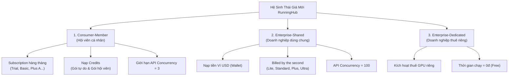
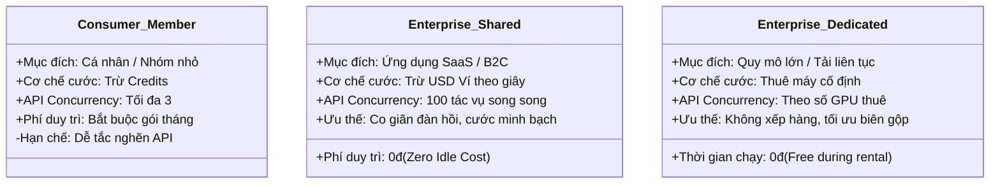

# Báo Cáo Toàn Diện: Phân Tích Bảng Giá Mới RunningHub & Tác Động Tới flowvis

> **Ngày lập báo cáo:** 07/11/2026  
> **Tỷ giá tham chiếu:** $1\text{ USD} = 25.500\text{ VNĐ}$  
> **Mục tiêu:** Bóc tách toàn bộ cơ cấu giá mới của RunningHub, quy đổi chi tiết sang VNĐ, phân tích ưu nhược điểm từng loại phí và xác định chiến lược tối ưu chi phí hạ tầng cho flowvis.

---

## 1. Tổng Quan Cơ Cấu Định Giá Mới của RunningHub

RunningHub đã chuyển dịch từ mô hình cước cũ (sử dụng **Coin** với giá cố định $0,4\text{ coin/giây}$) sang mô hình phân tầng đa dạng gồm **Credit**, **USD Wallet (Pay-as-you-go theo giây)** và **Thuê GPU riêng (Dedicated)**.

Hệ sinh thái giá mới được tổ chức thành 3 nhóm tài khoản chính:

---

## 2. Chi Tiết Các Loại Phí & Bảng Quy Đổi Sang VNĐ

### 2.1. Phí Thời Gian Chạy Máy GPU (Running Duration Billing)

Đây là thước đo giá vốn thực tế khi chạy ComfyUI / AI App. RunningHub niêm yết theo **USD / giờ** nhưng **tính tiền chi tiết tới từng giây chạy thực tế (Billed by the second)**:

$$\text{Phí 1 giây GPU} = \frac{\text{Đơn giá giờ}}{3.600\text{ giây}}$$

| Cấu hình máy | Đơn giá USD / giờ | Đơn giá VNĐ / giờ | Tiêu hao Credit (áp dụng Consumer) | Giá vốn thực tế / 1 giây GPU | Đặc tính phần cứng thường gặp |
| :--- | :---: | :---: | :---: | :---: | :--- |
| **Lite** | **\$0,15** | **3.825 VNĐ** | `0.03 credits/s` | **~1,06 VNĐ / giây** | CPU / GPU tải nhẹ, phù hợp tiền xử lý nhẹ |
| **Standard** | **\$0,88** | **22.440 VNĐ** | `0.17 credits/s` | **~6,23 VNĐ / giây** | Tương đương RTX 4090 / A4000 (mức giá cũ nạp lẻ) |
| **Plus** | **\$1,18** | **30.090 VNĐ** | `0.23 credits/s` | **~8,36 VNĐ / giây** | GPU 24GB – 48GB VRAM (A5000 / A6000 / 4090 cao cấp) |
| **Ultra** | **\$2,35** | **59.925 VNĐ** | `0.45 credits/s` | **~16,65 VNĐ / giây** | A100 / H100 80GB VRAM chuyên dụng model nặng |

> [!NOTE]
> **Không có phí nhàn rỗi (Zero Idle Cost):** Khi không có người dùng gọi API, GPU không chạy, hệ thống **không bị trừ bất kỳ cent nào**.

---

### 2.2. Gói Nạp Tiền Linh Hoạt ("Credits for everyone" - Dành Cho Mọi Người Dùng)

Dành cho tài khoản cá nhân nạp credits theo nhu cầu, có hạn dùng **1 năm**.

| Gói nạp | Giá (USD) | Giá quy đổi (VNĐ) | Credit nhận được | Bonus | Tỷ giá Credit / \$1 | Giá vốn 1 Credit (VNĐ) |
| :--- | :---: | :---: | :---: | :---: | :---: | :---: |
| **\$10 Pack** | \$10 | 255.000 VNĐ | 6.800 | 0 | 680 | **37,50 VNĐ** |
| **\$20 Pack** | \$20 | 510.000 VNĐ | 13.600 | 0 | 680 | **37,50 VNĐ** |
| **\$50 Pack** | \$50 | 1.275.000 VNĐ | 35.700 | +1.700 | 714 | **35,71 VNĐ** |
| **\$100 Pack** | \$100 | 2.550.000 VNĐ | 71.400 | +3.400 | 714 | **35,71 VNĐ** |
| **\$500 Pack** | \$500 | 12.750.000 VNĐ | 357.000 | +17.000 | 714 | **35,71 VNĐ** |

* **Ưu điểm:** Linh hoạt, không ràng buộc subscription, hạn dùng dài (1 năm).
* **Nhược điểm:** Giá mỗi credit cao hơn gói hội viên; nếu dùng tài khoản Consumer thì vẫn bị nghẽn API Concurrency = 3.

---

### 2.3. Gói Hội Viên Hàng Tháng (Consumer Monthly Subscription)

Dành cho người dùng trả phí thuê bao định kỳ để nhận hạn mức credits hàng tháng và quyền ưu tiên hàng đợi.

| Gói hội viên | Giá ưu đãi / tháng | Giá gốc | Quy đổi VNĐ / tháng | Credits / chu kỳ | Concurrency Web | Giới hạn API Concurrency | ComfyUI Priority Queue |
| :--- | :---: | :---: | :---: | :---: | :---: | :---: | :--- |
| **Trial** | **\$9,9** | \$11,9 | **252.450 VNĐ** | 6.700 | 3 | **3** | Không có |
| **Basic** | **\$18,9** | \$23,9 | **481.950 VNĐ** | 12.800 | 5 | **3** | Lite / Standard |
| **Plus A** | **\$27,9** | \$38,9 | **711.450 VNĐ** | 19.300 | 10 | **3** | **Tất cả các máy** |
| **Pro** | **\$161,9** | \$249,9 | **4.128.450 VNĐ** | 123.100 | 20 | **KHÔNG HỖ TRỢ** | **Tất cả các máy** |
| **Master A** | **\$249,9** | \$409,9 | **6.372.450 VNĐ** | 197.000 | 20 | **KHÔNG HỖ TRỢ** | **Tất cả các máy** |

* **Ưu điểm:** Giá credit rẻ hơn nạp lẻ, có hàng đợi ưu tiên ComfyUI trên máy mạnh (từ gói Plus A trở lên).
* **Nhược điểm cực lớn:** 
  * Cổng Consumer API bị **khóa cứng ở mức tối đa 3 tác vụ đồng thời**.
  * Gói Pro và Master A hoàn toàn **không cho phép dùng Consumer API**.

---

### 2.4. Gói Nạp Dành Riêng Cho Hội Viên (Member Value & Long-Term Credits)

Dành cho các tài khoản đang duy trì gói subscription muốn mua thêm credit với chiết khấu sâu.

#### A. Gói Member Value (Hiệu lực 31 ngày - Dành cho sáng tạo tập trung)
* **Create (\$139 $\approx$ 3.544.500 VNĐ):** 98.800 credits (89.900 + 8.900 bonus) $\rightarrow$ ~**35,88 VNĐ / credit**.
* **Create Plus (\$249 $\approx$ 6.349.500 VNĐ):** 189.800 credits (169.900 + 19.900 bonus) $\rightarrow$ ~**33,45 VNĐ / credit**.
* **Create Pro (\$889 $\approx$ 22.669.500 VNĐ):** 699.800 credits (599.900 + 99.900 bonus) $\rightarrow$ ~**32,39 VNĐ / credit**.
* **Create Ultra (\$2.949 $\approx$ 75.199.500 VNĐ):** 2.439.800 credits (1.999.900 + 439.900 bonus) $\rightarrow$ ~**30,82 VNĐ / credit**.
* **Create Max (\$5.889 $\approx$ 150.169.500 VNĐ):** 4.999.800 credits (3.999.900 + 999.900 bonus) $\rightarrow$ ~**30,03 VNĐ / credit**.

#### B. Gói Member Long-Term Booster (Hiệu lực 1 năm)
* **Plus Booster (\$1.029 $\approx$ 26.239.500 VNĐ):** 799.800 credits $\rightarrow$ ~**32,81 VNĐ / credit**.
* **Pro Booster (\$1.329 $\approx$ 33.889.500 VNĐ):** 1.099.800 credits $\rightarrow$ ~**30,81 VNĐ / credit**.
* **Ultimate Booster (\$2.359 $\approx$ 60.154.500 VNĐ):** 2.129.800 credits $\rightarrow$ ~**28,24 VNĐ / credit**.

---

## 3. Ma Trận So Sánh 3 Chế Độ Tài Khoản Cốt Lõi

### Bảng Phân Tích Đánh Giá Ưu & Nhược Điểm:

| Tiêu chí so sánh | ① Consumer-Member | ② Enterprise-Shared (Khuyên Dùng) | ③ Enterprise-Dedicated |
| :--- | :--- | :--- | :--- |
| **Hình thức nạp & gọi** | Mua gói tháng + nạp credits trung gian | **Nạp trực tiếp USD vào Ví (Wallet recharge)** | Kích hoạt thuê GPU riêng + nạp ví |
| **Các API hỗ trợ** | Chỉ AI App / ComfyUI (bị cắt ở Pro/Master) | **Toàn bộ:** AI App, ComfyUI, Model API, LLM | AI App, ComfyUI (Model/LLM không hỗ trợ) |
| **API Concurrency** | **Cố định = 3** | **Shared Quota = 100** | Bằng số lượng GPU đã thuê |
| **Cơ chế tính tiền** | Trừ dần credits | **Trừ tiền USD trực tiếp theo từng giây** | Miễn phí thời gian chạy trong hạn thuê |
| **Ưu điểm lớn nhất** | Dễ dùng thử qua Web | **Concurrency cực lớn (100), không phí duy trì, trừ đúng giây GPU** | Tốc độ tức thì không chờ đợi, chi phí/lượt chạy cực rẻ khi tải lớn |
| **Nhược điểm lớn nhất** | Nghẽn mạng ngay khi có >3 tác vụ; Pro/Master cấm API | Cần kiểm soát chi phí từng giây đối với workflow nặng | Chi phí cố định hàng tháng cao, lãng phí khi ít khách |

---

## 4. Tác Động Kinh Tế Trực Tiếp Tới flowvis (Unit Economics)

Hệ thống flowvis bán credit cho người dùng theo 3 gói nạp VietQR:
* **Gói Starter (49.000 VNĐ = 5.000 credit):** Thu **980 VNĐ / 100 credit**.
* **Gói Pro (99.000 VNĐ = 12.000 credit):** Thu **825 VNĐ / 100 credit**.
* **Gói Creator (199.000 VNĐ = 30.000 credit):** Thu **663 VNĐ / 100 credit**.

### 4.1. Tác Vụ Ảnh Tĩnh: Face Swap & Body Retouch (Giá bán: 100 credit flowvis)
* Thời gian xử lý: **3 – 5 giây GPU**.

| Máy chạy trên RunningHub | Giá vốn GPU / ảnh (VNĐ) | Doanh thu tối thiểu (Gói Creator) | Biên lợi nhuận gộp (Gross Margin) | Đánh giá rủi ro |
| :--- | :---: | :---: | :---: | :--- |
| **Standard** (\$0,88/h) | **18,7 – 31,2 VNĐ** | 663 VNĐ | **95,3% – 97,2%** | **Tuyệt đối an toàn** |
| **Plus** (\$1,18/h) | **25,1 – 41,8 VNĐ** | 663 VNĐ | **93,7% – 96,2%** | **Tuyệt đối an toàn** |
| **Ultra** (\$2,35/h) | **50,0 – 83,3 VNĐ** | 663 VNĐ | **87,4% – 92,5%** | **Rất tốt** |

> [!TIP]
> Tác vụ ảnh tĩnh có biên lợi nhuận cực dày (> 93%). Bất kể RunningHub chạy ở loại máy nào, mảng ảnh tĩnh luôn mang lại dòng tiền lãi rất vững chắc.

---

### 4.2. Tác Vụ Video: Motion Control (Giá bán: 50 credit flowvis / giây video)
* Tiêu hao GPU theo PRD: **1 giây video đầu ra cần ~13 giây GPU**.
* Doanh thu flowvis thu về mỗi giây video:
  * Starter: **490,0 VNĐ / giây**
  * Pro: **412,5 VNĐ / giây**
  * Creator: **331,5 VNĐ / giây**

| Kịch bản máy chạy | Giá vốn 1s video (13s GPU) | Biên gộp Gói Starter | Biên gộp Gói Pro | Biên gộp Gói Creator | Đạt chuẩn PRD §12 ($\ge 70\%$)? |
| :--- | :---: | :---: | :---: | :---: | :---: |
| **Mô hình cũ (nạp lẻ)** | *74,0 VNĐ* | *84,9%* | *82,0%* | *77,6%* | *Đạt* |
| **Máy Standard (\$0,88/h)** | **81,0 VNĐ** | **83,5%** | **80,4%** | **75,6%** | **ĐẠT** |
| **Máy Plus (\$1,18/h)** | **108,7 VNĐ** | **77,8%** | **73,6%** | **67,2%** | **DƯỚI CHUẨN** ($< 70\%$) |
| **Máy Ultra (\$2,35/h)** | **216,5 VNĐ** | **55,8%** | **47,5%** | **34,7%** | **BÁO ĐỘNG ĐỎ** |

> [!WARNING]
> **Điểm nhạy cảm sống còn:** 
> * Nếu workflow Motion Control ComfyUI chạy được trên máy **Standard**, biên gộp đạt **75,6%** (đạt chuẩn an toàn).
> * Nếu workflow cần VRAM lớn bắt buộc chạy trên máy **Plus**, biên gộp của gói Creator giảm xuống **67,2%**. Khi áp dụng thêm chiết khấu affiliate / voucher 10–15%, biên lãi chỉ còn ~52–57%.

---

### 4.3. Đánh Giá Rủi Ro 500 Credit Tặng Miễn Phí (Sign-up Bonus)
* 500 credit tặng = **5 ảnh tĩnh** HOẶC **10 giây video Motion Control**.
* Chi phí GPU nếu tài khoản dùng hết 500 credit để render video (130 giây GPU):
  * Chạy Standard: **~810 VNĐ / tài khoản**.
  * Chạy Plus: **~1.087 VNĐ / tài khoản**.
  * Chạy Ultra: **~2.165 VNĐ / tài khoản**.
* Với ngân sách thử nghiệm MVP **\$50 – \$100 (1.275.000 – 2.550.000 VNĐ)**:
  * Nếu chạy máy Plus, ngân sách này sẽ chịu được tối đa khoảng **1.100 – 2.300 lượt tạo video miễn phí**. Cần giữ chặt cơ chế chặn Fingerprint + tối đa 3 tài khoản/IP/24h như đã thiết kế ở Story 1.8.

---

## 5. Kết Luận & Khuyến Nghị Chiến Lược

###  Hành Động Ngay (Giai đoạn MVP & Launching):
1. **Chọn ngay mô hình `Enterprise-Shared`:** 
   * Không mua subscription hàng tháng Consumer. Nạp tiền trực tiếp vào Ví RunningHub (\$50 – \$100 ban đầu).
   * Hưởng trọn vẹn **100 API Concurrency**, bảo đảm hệ thống không bao giờ bị nghẽn lệnh.
2. **Tiến hành đo kiểm thực tế tại Pre-launch Benchmark (PRD §12):**
   * Kiểm tra xem workflow ComfyUI của flowvis khi chạy tham số mặc định (`instanceType: 'default'`) trên RunningHub sẽ ăn vào máy nào (Standard hay Plus) và tiêu hao thực tế bao nhiêu USD/giây.
3. **Kích hoạt "Kế hoạch B" về giá nếu rơi vào máy Plus:**
   * Nếu benchmark xác nhận chạy máy Plus (giá vốn ~108,7 VNĐ/giây video):
     * **Phương án 1:** Nâng biểu phí Motion Control từ **50 lên 60 credit / giây video** (Gói Creator thu 398 VNĐ/s $\rightarrow$ kéo biên gộp lên **72,7%** an toàn).
     * **Phương án 2:** Giữ nguyên 50 credit/giây nhưng giảm số credit tặng kèm của gói Creator từ **30.000 xuống 25.000 credit**.

###  Lộ Trình Mở Rộng (Scale-up):
* Khi số lượng đơn hàng vượt **1.000 lượt render video/ngày** (chi phí GPU biến đổi > \$30 – \$40/ngày $\approx$ \$1.000/tháng):
  * Chuyển sang kích hoạt **Enterprise-Dedicated** (thuê GPU riêng theo tháng). Thời gian chạy sẽ thành **0đ (Free runtime)**, đẩy biên lợi nhuận gộp của toàn bộ hệ thống lên **trên 90%**.
